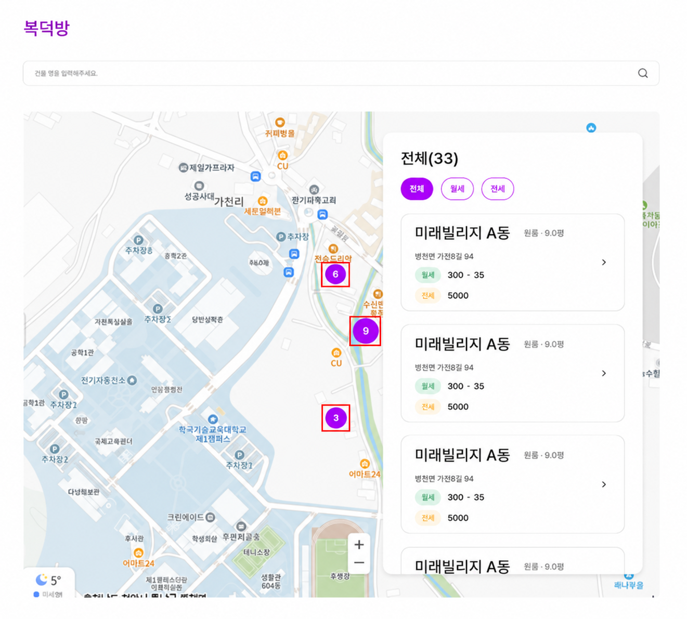

# 2-6 복덕방 목록_지도 묶음 마커 클릭

[← 로깅 목록](README.md)

생성일: 2026년 11월 19일 오후 2:26
platform: ANDROID, IOS, WEB
상태: 로깅 필요

상태: 명세 초안 · 사용자 제공 WEB 디자인 기준. SDK 구현·배포·실수집 미확인.

## 새 로깅 (26.11.17)

- 설명: 지도 위 매물 수가 숫자로 표시된 보라색 묶음 마커를 클릭할 때 클릭 1회당 기록한다.
- screen_view: `room_list`
- event_name: `DA1`
- event_label: `real_estate__room_list__map_cluster__click`
- value: 묶음 마커
- event_category: `click`

### 참고사진

**웹**

**참고사진 · 웹**

사용자 제공 복덕방 WEB 리디자인 참고 이미지다. 실기기·SDK 검증 사진이 아니며 앱 화면으로 분류하지 않는다.

웹 — 빨간 네모가 이 명세의 클릭 대상이다. 같은 화면의 다른 동작은 표시하지 않았다. 사용자 제공 WEB 디자인을 편집한 참고사진이며 실기기·SDK 검증 사진은 아니다.

### 참고사진 · 모바일

모바일 지도의 숫자 묶음 마커(예: 12·6·3)를 표시했다. 일반 목록의 방 카드 선택이나 검색 아이콘 클릭과 구분한다.

모바일 — 빨간 네모 = 해당 클릭·선택 위치. 사용자 제공 디자인을 편집한 참고사진이며 플랫폼별 SDK 구현·실수집 검증 사진은 아니다.