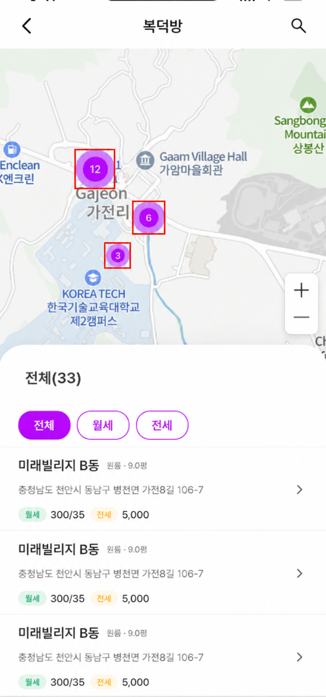

# 2-6 복덕방 목록_지도 묶음 마커 클릭

[← 복덕방 목록](README.md)

플랫폼: ANDROID, IOS, WEB  
원문 상태: 로깅 필요  
[Notion 기준 명세](https://app.notion.com/p/95e0221954bc8319a16c8106dee64dd6)  
원본 ID: `95e0221954bc8319a16c8106dee64dd6`

<!-- notion-body:start -->
상태: 명세 초안 · 사용자 제공 WEB 디자인 기준. SDK 구현·배포·실수집 미확인.

## 새 로깅 (26.11.17)

- 설명: 지도 위 매물 수가 숫자로 표시된 보라색 묶음 마커를 클릭할 때 클릭 1회당 기록한다.
- screen\_view: <code>room_list</code>
- event\_name: <code>DA1</code>
- event\_label: <code>real_estate__room_list__map_cluster__click</code>
- value: 묶음 마커
- event\_category: <code>click</code>

### 참고사진

<b>웹</b>

<b>참고사진 · 웹</b>

사용자 제공 복덕방 WEB 리디자인 참고 이미지다. 실기기·SDK 검증 사진이 아니며 앱 화면으로 분류하지 않는다.


웹 — 빨간 네모가 이 명세의 클릭 대상이다. 같은 화면의 다른 동작은 표시하지 않았다. 사용자 제공 WEB 디자인을 편집한 참고사진이며 실기기·SDK 검증 사진은 아니다.

### 참고사진 · 모바일

모바일 지도의 숫자 묶음 마커(예: 12·6·3)를 표시했다. 일반 목록의 방 카드 선택이나 검색 아이콘 클릭과 구분한다.


모바일 — 빨간 네모 = 해당 클릭·선택 위치. 사용자 제공 디자인을 편집한 참고사진이며 플랫폼별 SDK 구현·실수집 검증 사진은 아니다.
<!-- notion-body:end -->

<details>
<summary>Notion 원문 속성 전체</summary>

```json
{
  "platform": [
    "ANDROID",
    "IOS",
    "WEB"
  ],
  "url": "https://app.notion.com/p/95e0221954bc8319a16c8106dee64dd6",
  "상태": "로깅 필요",
  "생성일": "2026-11-23T13:39:05.383Z",
  "이벤트 이름": "2-6 복덕방 목록\\_지도 묶음 마커 클릭"
}
```

</details>
