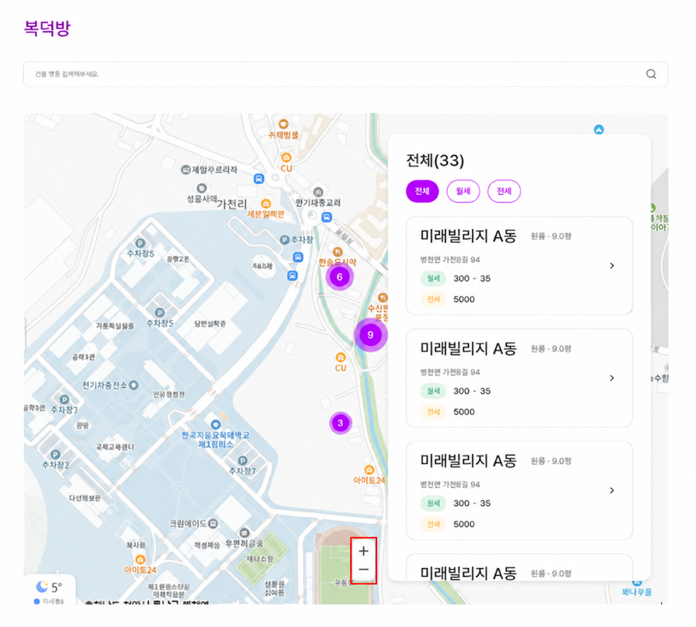
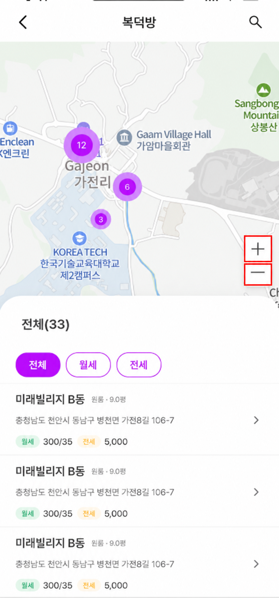

# 2-7 복덕방 목록_지도 확대·축소 버튼 클릭

[← 로깅 목록](README.md)

생성일: 2026년 11월 19일 오후 2:26
platform: ANDROID, IOS, WEB
상태: 로깅 필요

상태: 명세 초안 · 사용자 제공 웹·모바일 디자인 기준. SDK 구현·배포·실수집 미확인.

## 새 로깅 (26.11.17)

- 설명: 지도 오른쪽 아래의 + 확대 또는 - 축소 버튼을 사용자가 클릭할 때 클릭 1회당 기록한다.
- screen_view: `room_list`
- event_name: `DA1`
- event_label: `real_estate__room_list__map__zoom__click`
- value: 확대 / 축소 (예: 확대)
- event_category: `click`

### 참고사진

**웹**

**참고사진 · 웹**

사용자 제공 복덕방 WEB 리디자인 참고 이미지다. 실기기·SDK 검증 사진이 아니며 앱 화면으로 분류하지 않는다.

웹 — 빨간 네모가 이 명세의 클릭 대상이다. 같은 화면의 다른 동작은 표시하지 않았다. 사용자 제공 WEB 디자인을 편집한 참고사진이며 실기기·SDK 검증 사진은 아니다.

### 참고사진 · 모바일

앱에서도 지도 오른쪽의 + 확대 / − 축소 버튼 클릭에 같은 계약을 사용한다. value는 누른 버튼에 따라 확대 또는 축소로 기록한다. 플랫폼별 SDK 구현·배포·실수집은 미확인이다.

모바일 — 빨간 네모 = + 확대 버튼과 − 축소 버튼. 사용자 제공 최신 디자인을 편집한 참고사진이며 실기기·SDK 검증 사진은 아니다.