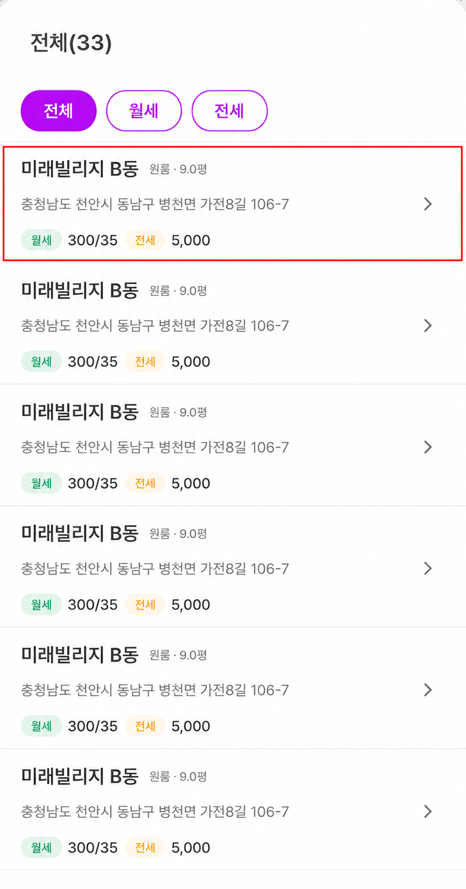
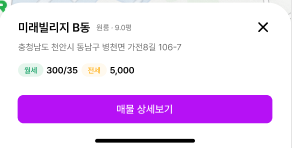

# 2-8 복덕방 목록_방 미리보기 선택 클릭 (모바일)

[← 로깅 목록](README.md)

생성일: 2026년 11월 19일 오후 2:26
platform: ANDROID, IOS
상태: 로깅 필요

상태: 명세 초안 · 사용자 제공 모바일 디자인 기준. 실제 플랫폼별 구현·배포·수집 미확인.

## 새 로깅 (26.11.17)

- 설명: 모바일 기본 지도·목록의 방 카드 오른쪽 > 버튼을 눌러 선택한 매물의 미리보기 패널 열기를 요청할 때 클릭 1회당 기록한다. 카드 본문도 같은 패널을 여는 구현이면 동일 계약으로 기록한다.
- screen_view: `room_list`
- event_name: `DA1`
- event_label: `real_estate__room_list__room_preview__entry__click`
- value: {선택한 방 이름} (예: 미래빌리지 B동)
- event_category: `click`

### 참고사진

**모바일**

**참고사진 · 모바일**

모바일 — 빨간 네모 = 해당 클릭 위치. 사용자 제공 모바일 디자인을 편집한 참고사진이며 iOS·Android별 SDK 구현·배포·실수집 검증 사진은 아니다.

### 클릭 후 도착 화면 · 모바일

목록의 > 클릭 → 아래 미리보기 패널이 열린다. 이 시점에는 상세 진입 로그(2-1)를 보내지 않는다. 패널의 매물 상세보기 버튼을 눌렀을 때만 2-1을 기록한다.

모바일 — 목록 > 클릭 후 열린 미리보기 패널. 도착 화면을 보여주는 사용자 제공 참고사진이다.