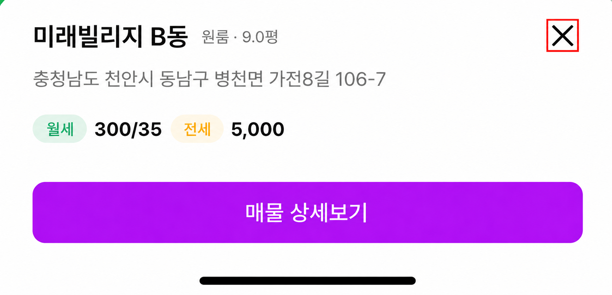

# 2-9 복덕방 미리보기_닫기 클릭 (모바일)

[← 복덕방 목록](README.md)

플랫폼: ANDROID, IOS  
원문 상태: 로깅 필요  
[Notion 기준 명세](https://app.notion.com/p/8620221954bc82ab8f4f814f2bdfaec6)  
원본 ID: `8620221954bc82ab8f4f814f2bdfaec6`

<!-- notion-body:start -->
상태: 명세 초안 · 사용자 제공 모바일 디자인 기준. 실제 플랫폼별 구현·배포·수집 미확인.

## 새 로깅 (26.11.17)

- 설명: 선택한 매물 미리보기 패널 오른쪽 위 X 버튼을 눌러 닫을 때 클릭 1회당 기록한다.
- screen\_view: <code>room_list</code>
- event\_name: <code>DA1</code>
- event\_label: <code>real_estate__room_list__room_preview__close__click</code>
- value: 닫기
- event\_category: <code>click</code>

### 참고사진

<b>모바일</b>

<b>참고사진 · 모바일</b>


모바일 — 빨간 네모 = 해당 클릭 위치. 사용자 제공 모바일 디자인을 편집한 참고사진이며 iOS·Android별 SDK 구현·배포·실수집 검증 사진은 아니다.
<!-- notion-body:end -->

<details>
<summary>Notion 원문 속성 전체</summary>

```json
{
  "platform": [
    "ANDROID",
    "IOS"
  ],
  "url": "https://app.notion.com/p/8620221954bc82ab8f4f814f2bdfaec6",
  "상태": "로깅 필요",
  "생성일": "2026-11-23T13:39:06.883Z",
  "이벤트 이름": "2-9 복덕방 미리보기\\_닫기 클릭 (모바일)"
}
```

</details>
