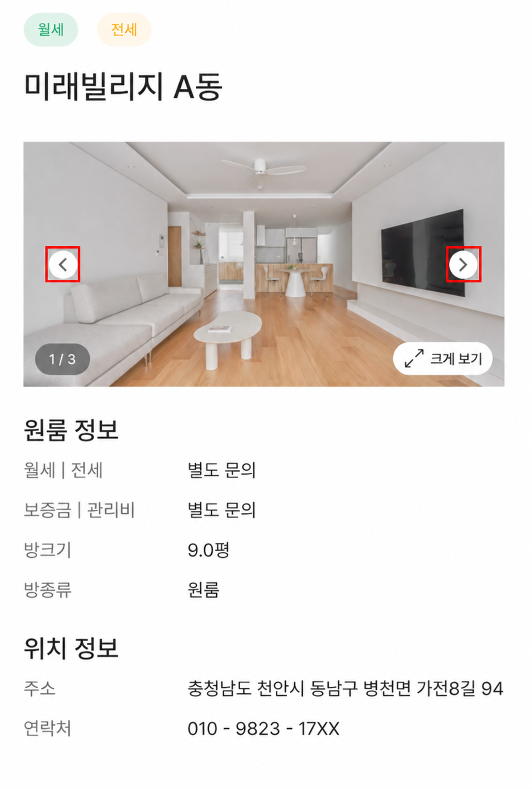

# 3-1 복덕방 상세_사진 넘기기 클릭

[← 로깅 목록](README.md)

생성일: 2026년 11월 19일 오후 2:26
platform: WEB
상태: 로깅 필요

- 새 로깅
    - 설명: 웹 복덕방 상세 화면의 방 사진 슬라이드에서 이전 / 다음 화살표를 클릭하는 경우
    - screen_view: `room_detail`
    - event_name: `DA1`
    - event_label:
        - 웹 `real_estate__room_detail__photo_view__slide__click`
        - 모바일`real_estate__room_detail__photo_view__slide__swipe`
    - value: 이전 / 다음 (예: 다음)
    - event_category:
        - 웹 : `click`
        - 모바일 : `swipe`
    
    ### 적용 범위
    
    ### 참고사진 (사진 슬라이드 다음 화살표)
    
    **웹**
    
    **참고사진 · 웹**
    
    
    
    웹 — 빨간 네모가 이 명세의 클릭 대상이다. 같은 화면의 다른 동작은 표시하지 않았다. 사용자 제공 WEB 디자인을 편집한 참고사진이며 실기기·SDK 검증 사진은 아니다.
    
    **모바일**
    
    **참고사진 · 모바일**
    
    
    
    모바일 — 빨간 네모 = 사진 표시 영역 보조 참고(화살표 클릭을 뜻하지 않음). 사용자 제공 디자인을 편집한 참고사진이며 플랫폼별 SDK 구현·실수집 검증 사진은 아니다.
> 플랫폼 확인 필요: 원본 속성은 WEB이지만 본문에는 모바일 swipe 계약과 이미지가 함께 있습니다. 원문을 그대로 보존했으며 IOS·ANDROID 지원이 확인된 것으로 간주하지 않습니다.
