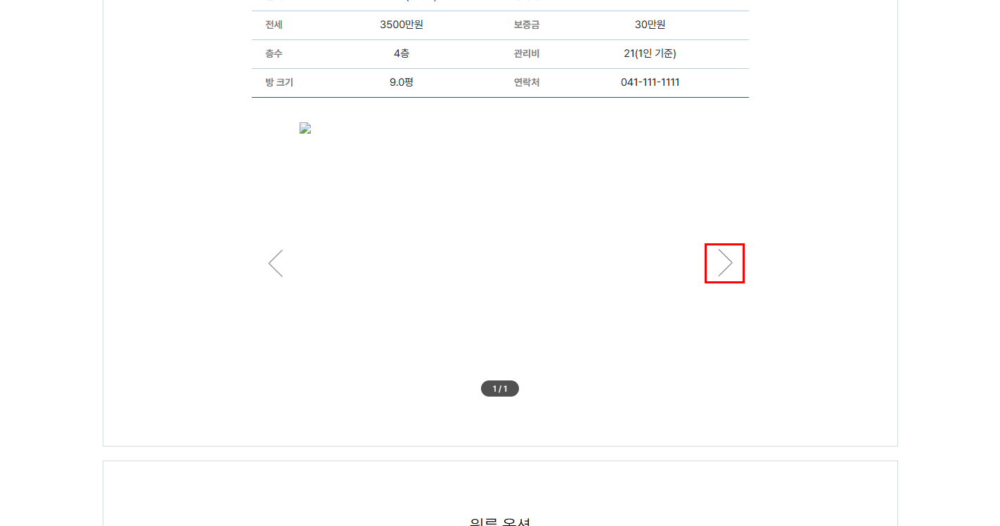
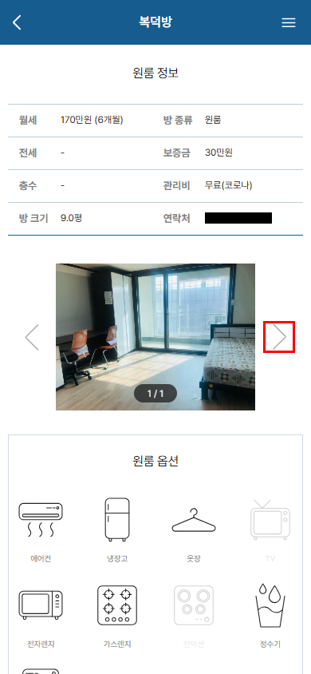

# 3-1 복덕방 상세_사진 넘기기 (클릭) - 추가된 로깅

[← 복덕방 로깅 목록](README.md)

플랫폼: ANDROID · IOS · WEB  
원문 상태: 로깅 필요

과거 로깅·새 로깅과 각 참고사진은 원문의 구간별 연결을 유지합니다.

<!-- logging-section:past:start -->
## 과거 로깅

- 없음 (새로 추가한 로깅)

<!-- logging-section:past:end -->

<!-- logging-section:new:start -->
## 새 로깅

- 설명: 복덕방 상세 화면의 방 사진 슬라이드에서 이전 / 다음 화살표를 클릭하는 경우
- screen\_view: <code>room_detail</code>
- event\_name: <code>DA1</code>
- event\_label: <code>real_estate__room_detail__photo_view__slide__click</code>
- value: 이전 / 다음 (예: 다음)
- event\_category: <code>click</code>

### 참고사진 (사진 슬라이드 다음 화살표)

<b>웹</b>

<b>참고사진 · 웹</b>

웹 — 사진 넘기기 (출처: stage 실제 캡처, 빨간 네모 = 클릭 위치)

<b>모바일</b>

<b>참고사진 · 모바일</b>

모바일 웹 · 운영 [https://koreatech.in/room/4](https://koreatech.in/room/4) 실제 파란색 화면을 2026-10-30에 캡처. 빨간 테두리: 상세 사진 오른쪽의 다음 화살표. 현재 매물 사진은 1/1이므로 실제 사진 전환은 미확인. Android/iOS 네이티브 앱 캡처가 아니며 SDK 발화·한 번 전송은 미확인.

<!-- logging-section:new:end -->

---

원문 정보

원본 ID: `57c0221954bc83b2a69a01fbf9ce1f79`  
[보존 원문](../../_archive/original/notion/pages/57c0221954bc83b2a69a01fbf9ce1f79.md)

