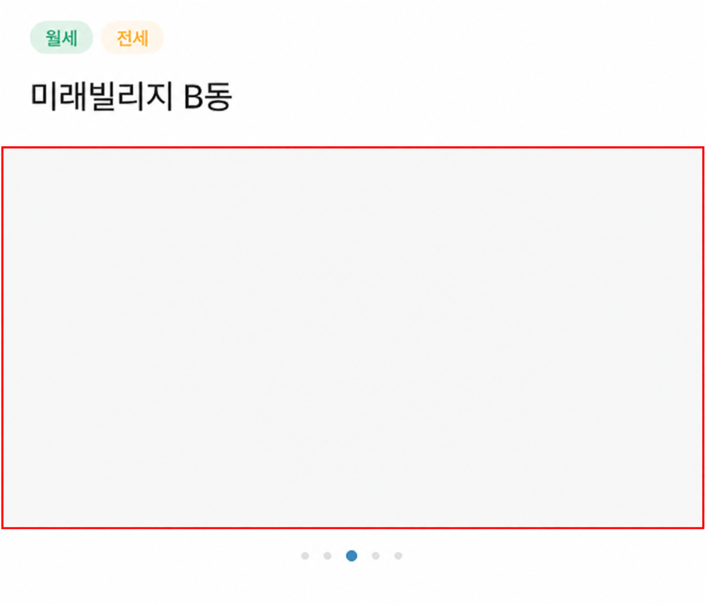

# 3-1 복덕방 상세_사진 넘기기 클릭

[← 복덕방 목록](README.md)

플랫폼: IOS, WEB, ANDROID  
원문 상태: 로깅 필요  
[Notion 기준 명세](https://app.notion.com/p/6310221954bc825f8599010867d0f47a)  
원본 ID: `6310221954bc825f8599010867d0f47a`

<!-- notion-body:start -->
### 플랫폼별 계약 범위

2026-11-28 사용자 확인: iOS·Android에서 손으로 사진을 넘기는 동작은 swipe다. 이 사진 넘기기 계약에 한해 IOS·ANDROID를 지원하며, 웹 화살표 click은 WEB으로 구분한다. 과거 수집값을 자동 개명하지 않는다.

| event\_label | platform |
| --- | --- |
| <code>real_estate__room_detail__photo_view__slide__click</code> | WEB |
| <code>real_estate__room_detail__photo_view__slide__swipe</code> | IOS, ANDROID |

## 새 로깅

- 설명: 복덕방 상세 사진을 웹 화살표로 넘기면 click, iOS·Android에서 손으로 밀어 넘기면 swipe로 기록한다. value는 이동한 사진 기준 이전 / 다음이며 취소한 제스처나 단순 터치는 제외한다.
- screen\_view: <code>room_detail</code>
- event\_name: <code>DA1</code>
- event\_label:

    - 웹 <code>real_estate__room_detail__photo_view__slide__click</code>
    - 모바일<code>real_estate__room_detail__photo_view__slide__swipe</code>
- value: 이전 / 다음 (예: 다음)
- event\_category:

  - 웹 : <code>click</code>
  - 모바일 : <code>swipe</code>

### 적용 범위

- 웹 화살표 click: WEB. 손으로 사진 넘기기 swipe: IOS·ANDROID. WEB swipe와 앱 click을 이 계약에 추가하지 않는다.
- click과 swipe의 라벨·category·발생 조건은 구분한다. 과거 전송을 자동 개명하거나 두 계약을 하나로 합치지 않는다.

### 참고사진 (사진 슬라이드 다음 화살표)

<b>웹</b>

<b>참고사진 · 웹</b>


웹 — 빨간 네모가 이 명세의 클릭 대상이다. 같은 화면의 다른 동작은 표시하지 않았다. 사용자 제공 WEB 디자인을 편집한 참고사진이며 실기기·SDK 검증 사진은 아니다.

<b>모바일</b>

<b>참고사진 · 모바일</b>


모바일 — 빨간 네모 = 사진 표시 영역 보조 참고(화살표 클릭을 뜻하지 않음). 사용자 제공 디자인을 편집한 참고사진이며 플랫폼별 SDK 구현·실수집 검증 사진은 아니다.
<!-- notion-body:end -->

<details>
<summary>Notion 원문 속성 전체</summary>

```json
{
  "platform": [
    "IOS",
    "WEB",
    "ANDROID"
  ],
  "url": "https://app.notion.com/p/6310221954bc825f8599010867d0f47a",
  "상태": "로깅 필요",
  "생성일": "2026-11-23T13:39:06.000Z",
  "이벤트 이름": "3-1 복덕방 상세\\_사진 넘기기 클릭"
}
```

</details>
