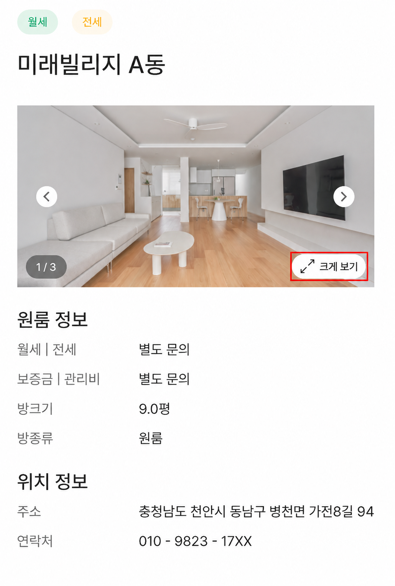

# 3-2 복덕방 상세_사진 크게 보기 클릭

[← 로깅 목록](README.md)

생성일: 2026년 11월 19일 오후 2:26
platform: WEB
상태: 로깅 필요

## 새 로깅 (26.11.17)

- 설명: 복덕방 상세 패널의 사진 오른쪽 아래 크게 보기 버튼을 클릭해 사진 확대 뷰 열기를 요청할 때 클릭 1회당 기록한다.
- screen_view: `room_detail`
- event_name: `DA1`
- event_label: `real_estate__room_detail__photo_view__expand__click`
- value: 크게 보기
- event_category: `click`

### 전송 기준

상세 사진의 이전·다음 화살표는 기존 3-1 명세다. 확대 뷰가 실제 열렸다는 노출 이벤트나 사진 변경 완료를 뜻하지 않는다.

### 참고사진

**웹**

**참고사진 · 웹**

사용자 제공 복덕방 WEB 리디자인 참고 이미지다. 실기기·SDK 검증 사진이 아니며 앱 화면으로 분류하지 않는다.

웹 — 빨간 네모가 이 명세의 클릭 대상이다. 같은 화면의 다른 동작은 표시하지 않았다. 사용자 제공 WEB 디자인을 편집한 참고사진이며 실기기·SDK 검증 사진은 아니다.