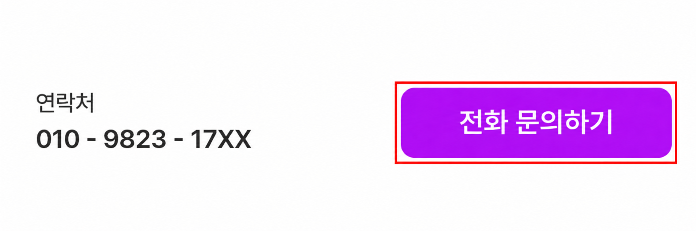

# 3-5 복덕방 상세_전화 문의하기 클릭 (모바일)

[← 로깅 목록](README.md)

생성일: 2026년 11월 19일 오후 2:26
platform: ANDROID, IOS
상태: 로깅 필요

상태: 명세 초안 · 사용자 제공 모바일 디자인 기준. 실제 플랫폼별 구현·배포·수집 미확인.

## 새 로깅 (26.11.17)

- 설명: 모바일 복덕방 상세 하단의 전화 문의하기 버튼을 눌러 전화 앱 또는 통화 확인 화면으로 이동을 시도할 때 클릭 1회당 기록한다.
- screen_view: `room_detail`
- event_name: `DA1`
- event_label: `real_estate__room_detail__contact__call__click`
- value: 전화 문의하기
- event_category: `click`

### 전송 기준

실제 발신·연결·상담 완료를 뜻하지 않는다. 연락처 텍스트 표시나 자동 전화 앱 전환을 추가 클릭으로 기록하지 않는다. 전화번호 원문·연락처는 파라미터로 전송하지 않는다.

### 참고사진

**모바일**

**참고사진 · 모바일**

모바일 — 빨간 네모 = 해당 클릭 위치. 사용자 제공 모바일 디자인을 편집한 참고사진이며 iOS·Android별 SDK 구현·배포·실수집 검증 사진은 아니다.