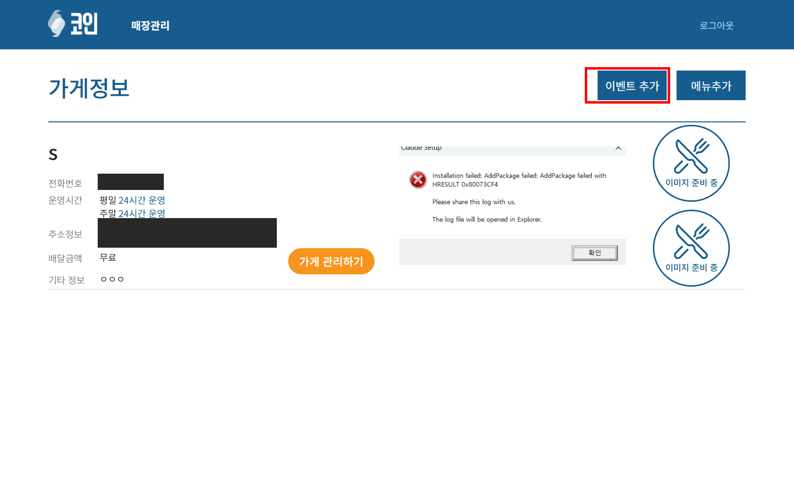

# 1-1 이벤트 추가 

[← 사장님 목록](README.md)

플랫폼: WEB  
원문 상태: 완료  
[Notion 기준 명세](https://app.notion.com/p/47d0221954bc82c6bd7301dd2fe6c3ac)  
원본 ID: `47d0221954bc82c6bd7301dd2fe6c3ac`

<!-- notion-body:start -->
## 과거 로깅

event\_params.key

- event\_label : add\_event
- value : 이벤트 추가
- event\_category : click

## 새 로깅

- 설명: 사장님 가게 정보 화면(/owner)에서 이벤트 추가(또는 이벤트 영역의 추가하기) 버튼을 클릭해 이벤트 추가 화면으로 들어가는 경우
- screen\_view: <code>owner_shop</code>
- event\_name: <code>DA1</code>
- event\_label: <code>owner__owner_shop__shop_event_manage__add_entry__click</code>
- value: 이벤트 추가
- event\_category: <code>click</code>

### 참고사진 (헤더의 이벤트 추가 버튼)

<b>웹</b>

<b>참고사진 · 웹</b>

웹 — 이벤트 추가 버튼 (출처: stage 실제 캡처, 빨간 네모 = 클릭 위치)



<b>모바일</b>

<b>참고사진 · 모바일</b>

모바일 — 해당 없음 (웹 전용)
<!-- notion-body:end -->

<details>
<summary>Notion 원문 속성 전체</summary>

```json
{
  "platform": [
    "WEB"
  ],
  "url": "https://app.notion.com/p/47d0221954bc82c6bd7301dd2fe6c3ac",
  "상태": "완료",
  "생성일": "2026-11-23T13:38:21.774Z",
  "이벤트 이름": "1-1 이벤트 추가 ",
  "태그": [
    "1. 이벤트 추가"
  ]
}
```

</details>
