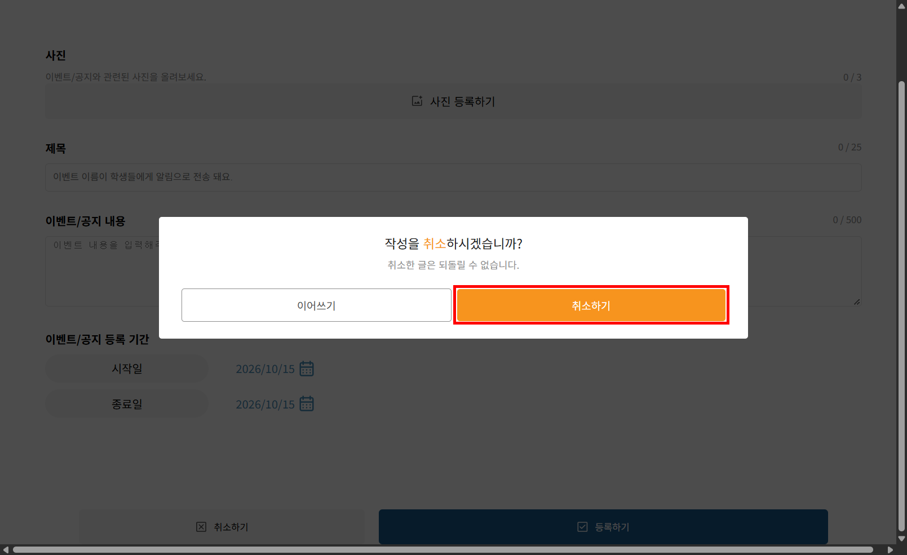

# 1-3 이벤트 추가 - 취소하기

[← 사장님 로깅 목록](README.md)

플랫폼: WEB  
원문 상태: 완료

과거 로깅·새 로깅과 각 참고사진은 원문의 구간별 연결을 유지합니다.

<!-- logging-section:past:start -->
## 과거 로깅

event\_params.key

- event\_label : add\_event\_cancel
- value : 이벤트 추가 취소
- event\_category : click

<!-- logging-section:past:end -->

<!-- logging-section:new:start -->
## 새 로깅

- 설명: 사장님 이벤트 추가 화면에서 취소하기를 누른 뒤 뜨는 확인 팝업(작성을 취소하시겠습니까?)에서 취소하기를 클릭해 작성을 그만두고 메인으로 나가는 경우
- screen\_view: <code>owner_event_add</code>
- event\_name: <code>DA1</code>
- event\_label: <code>owner__owner_event_add__shop_event_manage__add_cancel__click</code>
- value: 이벤트 추가 취소
- event\_category: <code>click</code>

### 참고사진 (작성 취소 확인 팝업의 취소하기)

<b>웹</b>

<b>참고사진 · 웹</b>

웹 — 작성 취소 확인 팝업 (출처: stage 실제 캡처, 빨간 네모 = 클릭 위치)

<b>모바일</b>

<b>참고사진 · 모바일</b>

모바일 — 해당 없음 (웹 전용)

<!-- logging-section:new:end -->

---

원문 정보

원본 ID: `4e40221954bc82a6bb600166cab24cef`  
[보존 원문](../../_archive/original/notion/pages/4e40221954bc82a6bb600166cab24cef.md)

