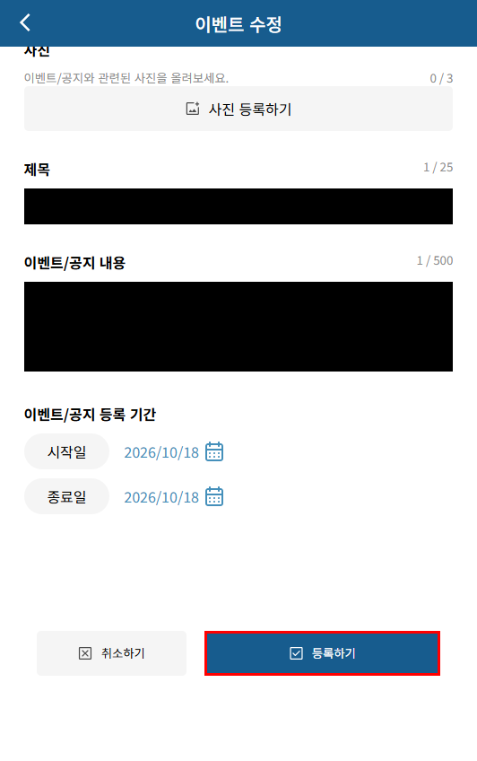

# 1-5 이벤트 수정 - 수정하기 (클릭) - 추가된 로깅

[← 사장님 로깅 목록](README.md)

플랫폼: WEB  
원문 상태: 로깅 필요

과거 로깅·새 로깅과 각 참고사진은 원문의 구간별 연결을 유지합니다.

<!-- logging-section:past:start -->
## 과거 로깅

- 없음 (새로 추가한 로깅)

<!-- logging-section:past:end -->

<!-- logging-section:new:start -->
## 새 로깅

- 설명: 사장님 가게 정보 화면(/owner)의 이벤트/공지 탭(좁은 화면 레이아웃에서만 보임)에서 편집하기 → 이벤트 선택 → 수정으로 들어간 이벤트 수정 화면(/owner/event-modify/\{id\})에서 제목·내용·기간을 고친 뒤 하단 등록하기 버튼을 클릭해 이벤트를 저장하는 경우
- screen\_view: <code>owner_event_modify</code>
- event\_name: <code>DA1</code>
- event\_label: <code>owner__owner_event_modify__shop_event_manage__edit_confirm__click</code>
- value: 이벤트 수정
- event\_category: <code>click</code>

### 참고사진 (이벤트 수정 화면 하단 등록하기 버튼, 좁은 화면 레이아웃)

#### 웹

WEB · 2026-10-30 [owner.stage.koreatech.in/owner/event-modify/118](http://owner.stage.koreatech.in/owner/event-modify/118) 실제 사장님 웹의 등록하기 버튼. 기존 이벤트의 수정 화면을 열어 촬영했으며 입력 내용은 검은색 마스킹. 실제 수정 저장·제출은 수행하지 않았다. 좁은 데스크톱 브라우저 창이며 네이티브 앱 사진이 아니다.

모바일 — 해당 없음 (웹 전용)

<!-- logging-section:new:end -->

---

원문 정보

원본 ID: `73e0221954bc82838331016f6849b8ae`  
[보존 원문](../../_archive/original/notion/pages/73e0221954bc82838331016f6849b8ae.md)

