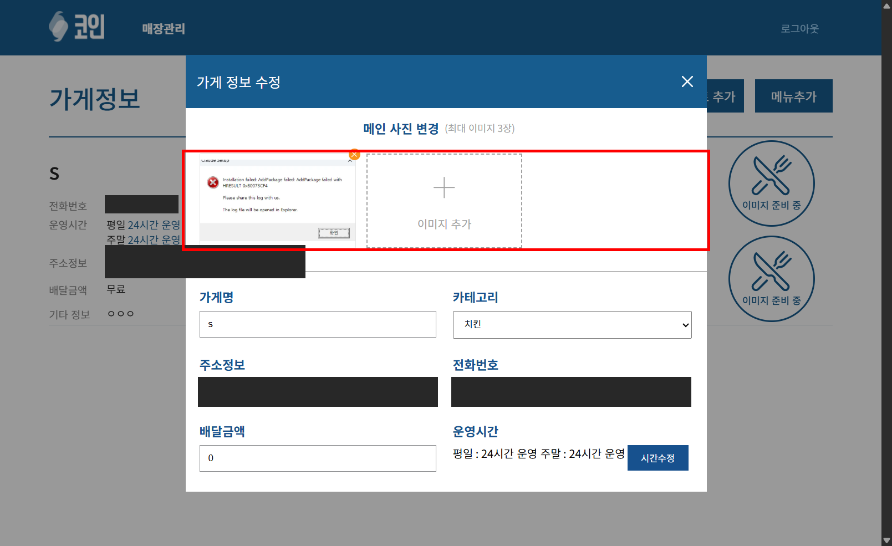

# 2-4 가게 정보 수정 - 이미지 추가 

[← 사장님 목록](README.md)

플랫폼: WEB  
원문 상태: 완료  
[Notion 기준 명세](https://app.notion.com/p/ef60221954bc828c8883018ee3211682)  
원본 ID: `ef60221954bc828c8883018ee3211682`

<!-- notion-body:start -->
## 과거 로깅

event\_params.key

- event\_label : store\_info\_edit\_add\_image
- value : 가게 정보 이미지 추가
- event\_category : click

## 새 로깅

- 설명: 사장님 가게 정보 수정 화면에서 대표 이미지 추가 칸을 클릭해 가게 사진을 골라 올리는 경우 (지금 코드는 사진을 고른 뒤 파일이 바뀌는 시점에 보냄)
- screen\_view: <code>owner_shop_edit</code>
- event\_name: <code>DA1</code>
- event\_label: <code>owner__owner_shop_edit__shop_manage__image_add__click</code>
- value: 가게 이미지 추가
- event\_category: <code>click</code>

### 참고사진 (대표 이미지 추가 칸)

<b>웹</b>

<b>참고사진 · 웹</b>

웹 — 가게 이미지 추가 (출처: stage 실제 캡처, 빨간 네모 = 클릭 위치)



<b>모바일</b>

<b>참고사진 · 모바일</b>

모바일 — 해당 없음 (웹 전용)
<!-- notion-body:end -->

<details>
<summary>Notion 원문 속성 전체</summary>

```json
{
  "platform": [
    "WEB"
  ],
  "url": "https://app.notion.com/p/ef60221954bc828c8883018ee3211682",
  "상태": "완료",
  "생성일": "2026-11-23T13:38:21.520Z",
  "이벤트 이름": "2-4 가게 정보 수정 - 이미지 추가 ",
  "태그": [
    "2. 가게 정보 수정"
  ]
}
```

</details>
