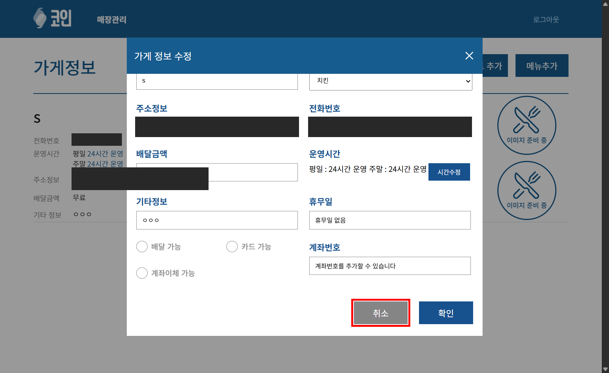

# 2-5 가게 정보 수정 - 취소

[← 사장님 로깅 목록](README.md)

플랫폼: WEB  
원문 상태: 완료

과거 로깅·새 로깅과 각 참고사진은 원문의 구간별 연결을 유지합니다.

<!-- logging-section:past:start -->
## 과거 로깅

event\_params.key

- event\_label : store\_info\_edit\_cancel
- value : 가게 정보 수정 취소
- event\_category : click

<!-- logging-section:past:end -->

<!-- logging-section:new:start -->
## 새 로깅

- 설명: 사장님 가게 정보 수정 화면 아래의 취소 버튼을 클릭해 저장하지 않고 가게 정보 화면으로 돌아가는 경우
- screen\_view: <code>owner_shop_edit</code>
- event\_name: <code>DA1</code>
- event\_label: <code>owner__owner_shop_edit__shop_manage__edit_cancel__click</code>
- value: 가게 정보 수정 취소
- event\_category: <code>click</code>

### 참고사진 (취소 버튼)

#### 웹

웹 — 가게 정보 수정 취소 (출처: stage 실제 캡처, 빨간 네모 = 클릭 위치)

모바일 — 해당 없음 (웹 전용)

<!-- logging-section:new:end -->

---

원문 정보

원본 ID: `8360221954bc836c8c650163d19c77e6`  
[보존 원문](../../_archive/original/notion/pages/8360221954bc836c8c650163d19c77e6.md)

