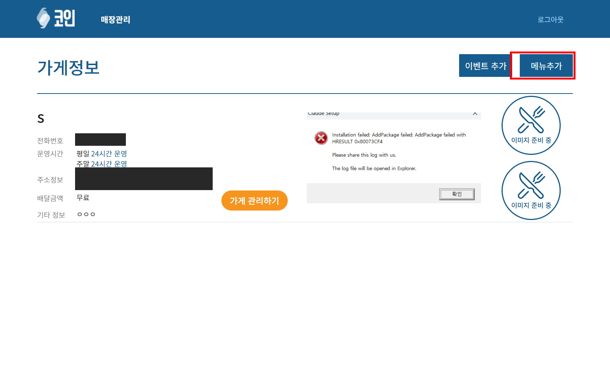

# 3-1 메뉴추가

[← 사장님 로깅 목록](README.md)

플랫폼: WEB  
원문 상태: 완료

과거 로깅·새 로깅과 각 참고사진은 원문의 구간별 연결을 유지합니다.

<!-- logging-section:past:start -->
## 과거 로깅

event\_params.key

- event\_label : add\_menu
- value : 메뉴 추가
- event\_category : click

<!-- logging-section:past:end -->

<!-- logging-section:new:start -->
## 새 로깅

- 설명: 사장님 가게 정보 화면(/owner)에서 메뉴추가 버튼을 클릭해 메뉴 추가 화면(/owner/add-menu)으로 들어가는 경우
- screen\_view: <code>owner_shop</code>
- event\_name: <code>DA1</code>
- event\_label: <code>owner__owner_shop__shop_menu_manage__add_entry__click</code>
- value: 메뉴 추가
- event\_category: <code>click</code>

### 참고사진 (메뉴추가 버튼)

#### 웹

웹 — 메뉴 추가 (출처: stage 실제 캡처, 빨간 네모 = 클릭 위치)

모바일 — 해당 없음 (웹 전용)

<!-- logging-section:new:end -->

---

원문 정보

원본 ID: `6010221954bc822fad650108832d38f4`  
[보존 원문](../../_archive/original/notion/pages/6010221954bc822fad650108832d38f4.md)

