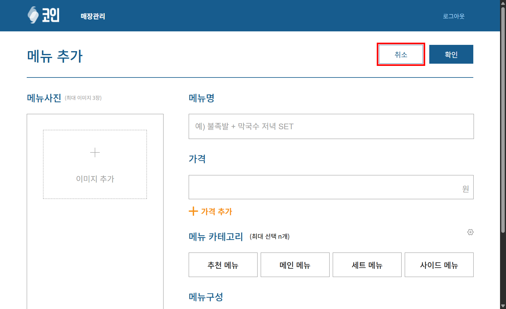

# 3-3 메뉴추가 - 취소

[← 사장님 로깅 목록](README.md)

플랫폼: WEB  
원문 상태: 진행 중

과거 로깅·새 로깅과 각 참고사진은 원문의 구간별 연결을 유지합니다.

<!-- logging-section:past:start -->
## 과거 로깅

event\_params.key

- event\_label : add\_menu\_cancel
- value : 메뉴 추가 취소
- event\_category : click

콘솔에서 오류 이슈 

/owner:1 Mixed Content: The page at '[https://owner.stage.koreatech.in/owner](https://owner.stage.koreatech.in/owner)' was loaded over HTTPS, but requested an insecure element '[http://static.koreatech.in/assets/img/ic-bcsd\_gray.png](http://static.koreatech.in/assets/img/ic-bcsd_gray.png)'. This request was automatically upgraded to HTTPS, For more information see [https://blog.chromium.org/2019/10/no-more-mixed-messages-about-https.html](https://blog.chromium.org/2019/10/no-more-mixed-messages-about-https.html)

<!-- logging-section:past:end -->

<!-- logging-section:new:start -->
## 새 로깅

- 설명: 사장님 메뉴 추가 화면에서 취소 버튼을 클릭해 등록하지 않고 가게 정보 화면(/owner)으로 돌아가는 경우
- screen\_view: <code>owner_menu_add</code>
- event\_name: <code>DA1</code>
- event\_label: <code>owner__owner_menu_add__shop_menu_manage__add_cancel__click</code>
- value: 메뉴 추가 취소
- event\_category: <code>click</code>

### 참고사진 (취소 버튼)

<b>웹</b>

<b>참고사진 · 웹</b>

웹 — 메뉴 추가 취소 (출처: stage 실제 캡처, 빨간 네모 = 클릭 위치)

<b>모바일</b>

<b>참고사진 · 모바일</b>

모바일 — 해당 없음 (웹 전용)

<!-- logging-section:new:end -->

---

원문 정보

원본 ID: `c840221954bc82f6ac96814ed5b53c23`  
[보존 원문](../../_archive/original/notion/pages/c840221954bc82f6ac96814ed5b53c23.md)

