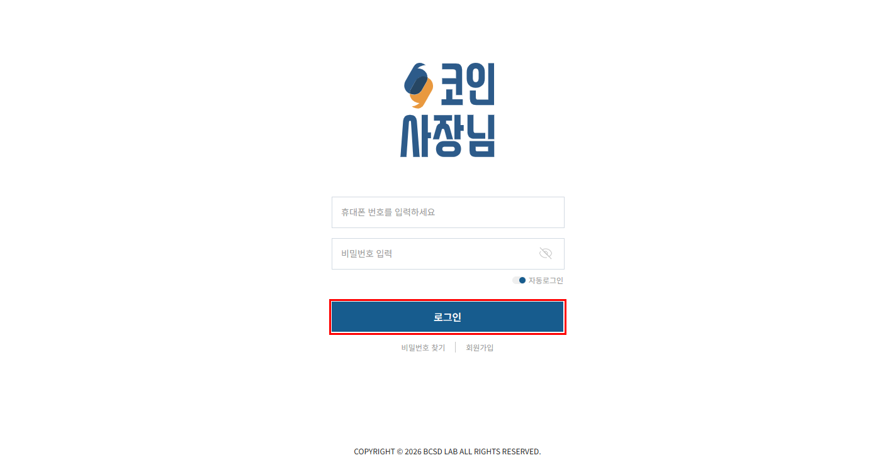

# 4-1 로그인 (클릭) - 추가된 로깅

[← 사장님 목록](README.md)

플랫폼: WEB  
원문 상태: 로깅 필요  
[Notion 기준 명세](https://app.notion.com/p/2370221954bc83e794b381da6beb2726)  
원본 ID: `2370221954bc83e794b381da6beb2726`

<!-- notion-body:start -->
## 과거 로깅

- 없음 (새로 추가한 로깅)

## 새 로깅

- 설명: 사장님 로그인 화면(/login)에서 휴대폰 번호·비밀번호를 입력한 뒤 로그인 버튼을 클릭하는 경우
- screen\_view: <code>owner_login</code>
- event\_name: <code>DA1</code>
- event\_label: <code>owner__owner_login__login__entry__click</code>
- value: 로그인
- event\_category: <code>click</code>

### 참고사진 (로그인 버튼)

<b>웹</b>

<b>참고사진 · 웹</b>

웹 — 로그인 (출처: stage 실제 캡처, 빨간 네모 = 클릭 위치)



<b>모바일</b>

<b>참고사진 · 모바일</b>

파란색 구버전 모바일 사진 제거 (2026-10-30).
<!-- notion-body:end -->

<details>
<summary>Notion 원문 속성 전체</summary>

```json
{
  "platform": [
    "WEB"
  ],
  "url": "https://app.notion.com/p/2370221954bc83e794b381da6beb2726",
  "상태": "로깅 필요",
  "생성일": "2026-11-23T13:38:24.970Z",
  "이벤트 이름": "4-1 로그인 (클릭) - 추가된 로깅"
}
```

</details>
