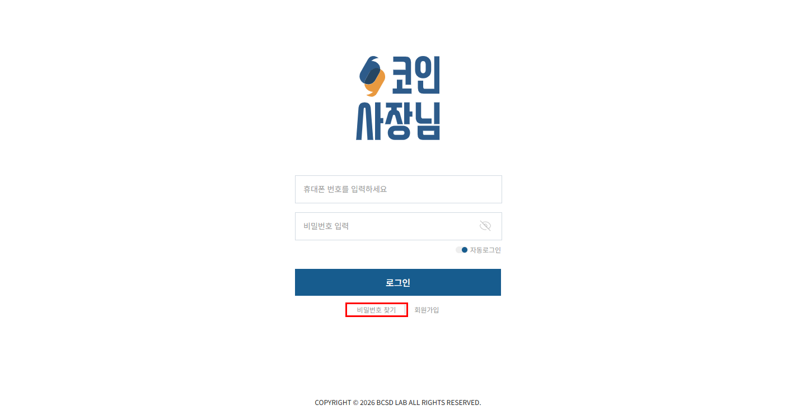

# 4-2 로그인 - 비밀번호 찾기 (클릭) - 추가된 로깅

[← 사장님 로깅 목록](README.md)

플랫폼: WEB  
원문 상태: 로깅 필요

과거 로깅·새 로깅과 각 참고사진은 원문의 구간별 연결을 유지합니다.

<!-- logging-section:past:start -->
## 과거 로깅

- 없음 (새로 추가한 로깅)

<!-- logging-section:past:end -->

<!-- logging-section:new:start -->
## 새 로깅

- 설명: 사장님 로그인 화면(/login) 하단의 비밀번호 찾기를 클릭해 비밀번호 찾기 화면(/find-password)으로 들어가는 경우
- screen\_view: <code>owner_login</code>
- event\_name: <code>DA1</code>
- event\_label: <code>owner__owner_login__account_recovery__password_entry__click</code>
- value: 비밀번호 찾기
- event\_category: <code>click</code>

### 참고사진 (비밀번호 찾기)

<b>웹</b>

<b>참고사진 · 웹</b>

웹 — 비밀번호 찾기 (출처: stage 실제 캡처, 빨간 네모 = 클릭 위치)

<b>모바일</b>

<b>참고사진 · 모바일</b>

파란색 구버전 모바일 사진 제거 (2026-10-30).

<!-- logging-section:new:end -->

---

원문 정보

원본 ID: `b650221954bc83e09fff01e77cd4fe45`  
[보존 원문](../../_archive/original/notion/pages/b650221954bc83e09fff01e77cd4fe45.md)

