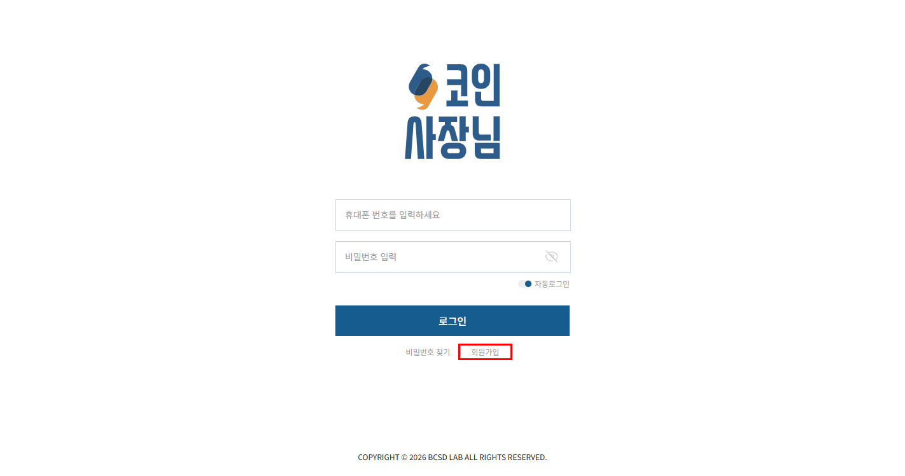

# 4-3 로그인 - 회원가입 (클릭) - 추가된 로깅

[← 사장님 로깅 목록](README.md)

플랫폼: WEB  
원문 상태: 로깅 필요

과거 로깅·새 로깅과 각 참고사진은 원문의 구간별 연결을 유지합니다.

<!-- logging-section:past:start -->
## 과거 로깅

- 없음 (새로 추가한 로깅)

<!-- logging-section:past:end -->

<!-- logging-section:new:start -->
## 새 로깅

- 설명: 사장님 로그인 화면(/login) 하단의 회원가입을 클릭해 회원가입 화면(/signup)으로 들어가는 경우
- screen\_view: <code>owner_login</code>
- event\_name: <code>DA1</code>
- event\_label: <code>owner__owner_login__sign_up__entry__click</code>
- value: 회원가입
- event\_category: <code>click</code>

### 참고사진 (회원가입)

<b>웹</b>

<b>참고사진 · 웹</b>

웹 — 회원가입 (출처: stage 실제 캡처, 빨간 네모 = 클릭 위치)

<b>모바일</b>

<b>참고사진 · 모바일</b>

파란색 구버전 모바일 사진 제거 (2026-10-30).

<!-- logging-section:new:end -->

---

원문 정보

원본 ID: `eef0221954bc8302a361815f65b5928a`  
[보존 원문](../../_archive/original/notion/pages/eef0221954bc8302a361815f65b5928a.md)

