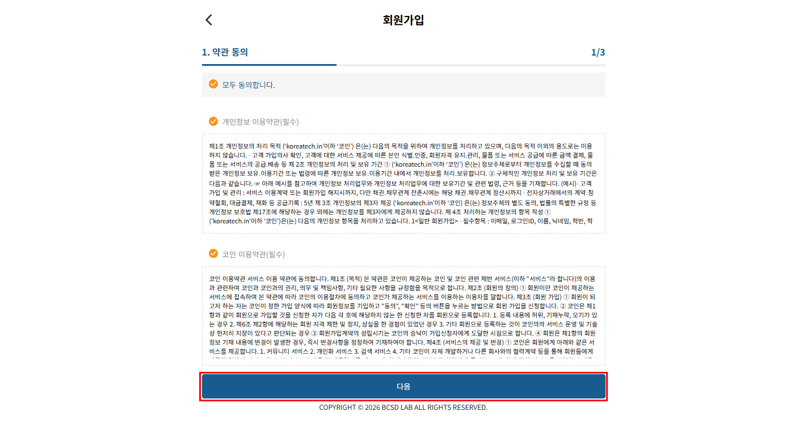
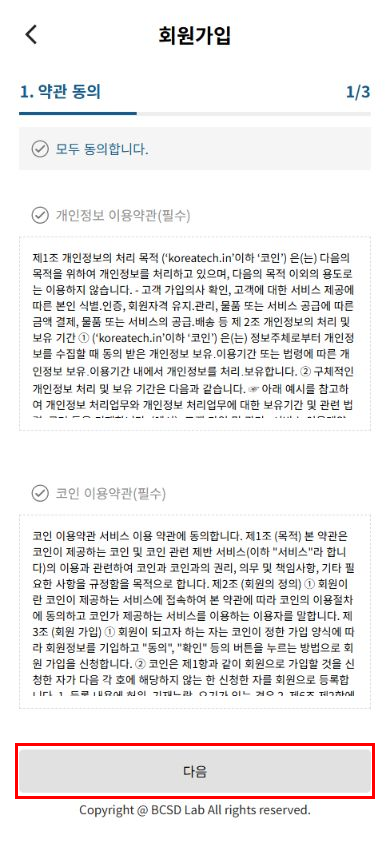

# 4-4 회원가입 - 다음 (클릭) - 추가된 로깅

[← 사장님 로깅 목록](README.md)

플랫폼: WEB  
원문 상태: 로깅 필요

과거 로깅·새 로깅과 각 참고사진은 원문의 구간별 연결을 유지합니다.

<!-- logging-section:past:start -->
## 과거 로깅

- 없음 (새로 추가한 로깅)

<!-- logging-section:past:end -->

<!-- logging-section:new:start -->
## 새 로깅

- 설명: 사장님 회원가입 화면(/signup)의 각 단계(약관동의 등)에서 다음 버튼을 클릭해 다음 단계로 넘어가는 경우 (단계별 이탈 확인용)
- screen\_view: <code>owner_signup</code>
- event\_name: <code>DA1</code>
- event\_label: <code>owner__owner_signup__sign_up__next__click</code>
- value: \{단계\} (예: 약관동의)
- event\_category: <code>click</code>

### 참고사진 (다음 버튼)

#### 웹

웹 — 회원가입 다음 (출처: stage 실제 캡처, 빨간 네모 = 클릭 위치)

#### 모바일

모바일 웹 · 빨간 네모: 사장님 회원가입 다음 버튼 · 약관 동의 전 비활성 상태. 가로 390px 반응형 stage 실제 화면. Android/iOS 앱 캡처와 구분.

<!-- logging-section:new:end -->

---

원문 정보

원본 ID: `8980221954bc824ca93c01b4ac9174e1`  
[보존 원문](../../_archive/original/notion/pages/8980221954bc824ca93c01b4ac9174e1.md)

