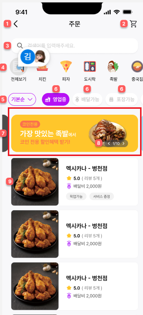

# 2-3 상점카테고리 이벤트 (클릭) 

[← 새 주변상점 - 레거시 목록](README.md)

플랫폼: ANDROID, IOS, WEB  
원문 상태: 완료  
[Notion 기준 명세](https://app.notion.com/p/e2f0221954bc8316b8298147cbc92b55)  
원본 ID: `e2f0221954bc8316b8298147cbc92b55`

<!-- notion-body:start -->


event\_params.key

- event\_label : shop\_categories\_event
- value : \{가게이름\}
- event\_category : click
- duration\_time : 이전 카테고리에서 현 상점으로 이동하는 시간
- previous\_page : \{이전 카테고리\}
- current\_page : \{가게이름\}

---
<!-- notion-body:end -->

<details>
<summary>Notion 원문 속성 전체</summary>

```json
{
  "platform": [
    "ANDROID",
    "IOS",
    "WEB"
  ],
  "url": "https://app.notion.com/p/e2f0221954bc8316b8298147cbc92b55",
  "상태": "완료",
  "생성일": "2026-11-23T13:39:08.509Z",
  "이벤트 이름": "2-3 상점카테고리 이벤트 (클릭) ",
  "태그": [
    "2. 상점 카테고리"
  ]
}
```

</details>
