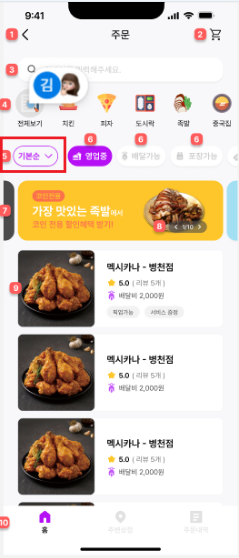
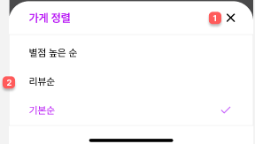

# 2-6~9 상점 카테고리 정렬 

[← 새 주변상점 - 레거시 목록](README.md)

플랫폼: ANDROID, IOS, WEB  
원문 상태: 완료  
[Notion 기준 명세](https://app.notion.com/p/5ce0221954bc824a9a2281adcae049b7)  
원본 ID: `5ce0221954bc824a9a2281adcae049b7`

<!-- notion-body:start -->
기존 기능 및 디자인 → 로깅 수정 및 추가(오른쪽 사진)






event\_params.key

- event\_label : shop\_can
- value :

  - check\_open\_\{카테고리\}
- event\_category : click

event\_params.key

- event\_label : shop\_can
- value :

  - check\_default\_\{카테고리\}
  - check\_review\_\{카테고리\}
  - check\_star\_\{카테고리\}
- event\_category : click
<!-- notion-body:end -->

<details>
<summary>Notion 원문 속성 전체</summary>

```json
{
  "platform": [
    "ANDROID",
    "IOS",
    "WEB"
  ],
  "url": "https://app.notion.com/p/5ce0221954bc824a9a2281adcae049b7",
  "상태": "완료",
  "생성일": "2026-11-23T13:39:07.953Z",
  "이벤트 이름": "2-6\\~9 상점 카테고리 정렬 ",
  "태그": [
    "2. 상점 카테고리"
  ]
}
```

</details>
