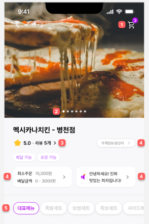

# [레거시] 3-3 상점 상세 스크롤 상점정보

> **레거시 문서** · 과거 구현과 로깅을 확인하기 위한 보존 자료입니다.

[← 새 주변상점 - 레거시 로깅 목록](README.md)

플랫폼: ANDROID · IOS · WEB  
원문 상태: 완료

원문에 과거·새 로깅 구분이 없어 아래 정의와 참고사진을 원문 순서로 표시합니다.

원문 미기재 항목: `event_name`, `screen_view`, `event_category`. 값을 추정하지 않았습니다.

숫자 4로 표시된 3가지 버튼 모두 동일한 로깅으로 심어주시면 됩니다!

event\_params.key

- event\_label : shop\_detail\_view\_info

- value : \{상점이름\} 

- event\_category : 

- click 

---

---

원문 정보

원본 ID: `1e30221954bc83db86f201a504341027`  
[보존 원문](../../_archive/original/notion/pages/1e30221954bc83db86f201a504341027.md)

