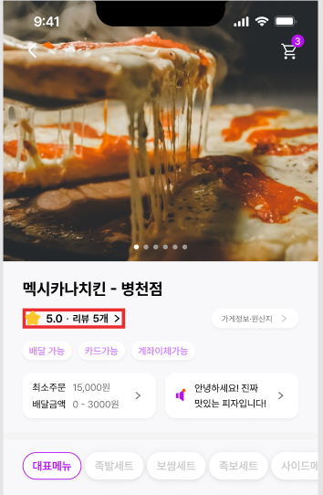

# [레거시] 4-1 상점상세 리뷰 (클릭)

> **레거시 문서** · 과거 구현과 로깅을 확인하기 위한 보존 자료입니다.

[← 새 주변상점 - 레거시 로깅 목록](README.md)

플랫폼: ANDROID · IOS · WEB  
원문 상태: 완료

원문에 과거·새 로깅 구분이 없어 아래 정의와 참고사진을 원문 순서로 표시합니다.

원문 미기재 항목: `event_name`, `screen_view`. 값을 추정하지 않았습니다.

event\_params.key

- event\_label : shop\_detail\_view\_review

- value : \{상점이름\} 

- event\_category : click

---

---

원문 정보

원본 ID: `b240221954bc82bca989014ef1bf9231`  
[보존 원문](../../_archive/original/notion/pages/b240221954bc82bca989014ef1bf9231.md)

