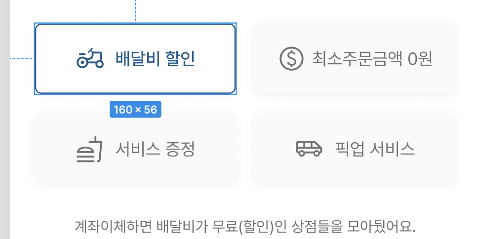

# [레거시] 4-2 전화 주문 혜택 페이지 버튼 → 버튼

> **레거시 문서** · 과거 구현과 로깅을 확인하기 위한 보존 자료입니다.

[← 새 주변상점 - 레거시 로깅 목록](README.md)

플랫폼: WEB · ANDROID · IOS  
원문 상태: 완료

원문에 과거·새 로깅 구분이 없어 아래 정의와 참고사진을 원문 순서로 표시합니다.

원문 미기재 항목: `event_name`, `screen_view`. 값을 추정하지 않았습니다.

event\_params.key

- event\_label : benefit\_shop\_categories

- value : \{버튼\}   //  (배달비, 최소주문금액, 서비스, 픽업) 

- event\_category : click  

- previous\_page : \{이전카테고리\}

- current\_page : \{현재 카테고리\}

- duration\_time : 이전 카테고리에서 현 카테고리로 이동하는 시간 

---

원문 정보

원본 ID: `f740221954bc82dbb3d80149e601d67a`  
[보존 원문](../../_archive/original/notion/pages/f740221954bc82dbb3d80149e601d67a.md)

