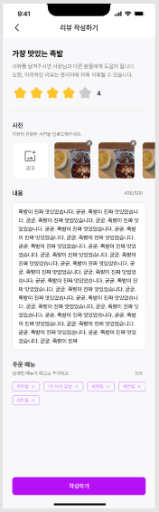

# [레거시] 4-3 상점상세 리뷰 작성 들어간 후 작성하기 (클릭)

> **레거시 문서** · 과거 구현과 로깅을 확인하기 위한 보존 자료입니다.

[← 새 주변상점 - 레거시 로깅 목록](README.md)

플랫폼: ANDROID · IOS · WEB  
원문 상태: 완료

원문에 과거·새 로깅 구분이 없어 아래 정의와 참고사진을 원문 순서로 표시합니다.

원문 미기재 항목: `event_name`, `screen_view`. 값을 추정하지 않았습니다.

리뷰 작성 페이지에 들어오고 내용 작성 후 작성하기 버튼 클릭 로깅입니다

event\_params.key

- event\_label : shop\_detail\_view\_review\_write\_done

- value : \{상점이름\} 

- event\_category : click

- duration\_time : 작성 페이지로 들어와서 쓰기 까지 걸린시간

---

---

원문 정보

원본 ID: `3970221954bc831f8c6a81171d7cae05`  
[보존 원문](../../_archive/original/notion/pages/3970221954bc831f8c6a81171d7cae05.md)

