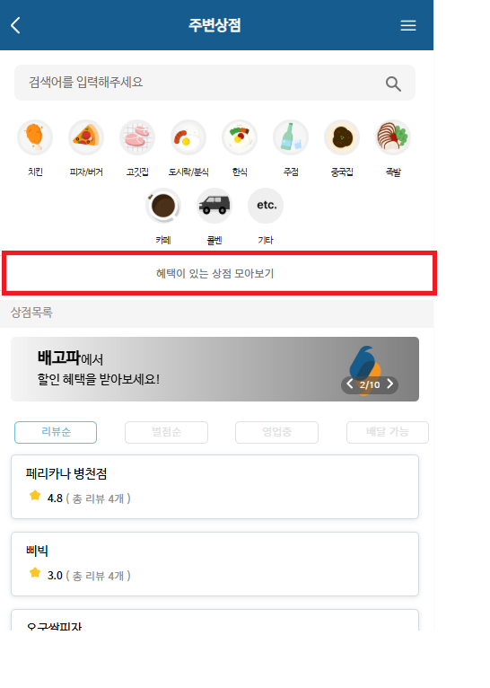

# 4-3 카테고리에서 혜택페이지(클릭) 

[← 새 주변상점 - 레거시 목록](README.md)

플랫폼: WEB, ANDROID, IOS  
원문 상태: 완료  
[Notion 기준 명세](https://app.notion.com/p/7220221954bc834398de81f3236bb23c)  
원본 ID: `7220221954bc834398de81f3236bb23c`

<!-- notion-body:start -->
event\_params.key

- event\_label : shop\_categories\_benefit
- value : 혜택이 있는 상점 모아보기
- event\_category : click <br />
- previous\_page : \{이전카테고리\}
- current\_page : benefit
- duration\_time : 이전 카테고리에서 현 카테고리로 이동하는 시간


<!-- notion-body:end -->

<details>
<summary>Notion 원문 속성 전체</summary>

```json
{
  "platform": [
    "WEB",
    "ANDROID",
    "IOS"
  ],
  "url": "https://app.notion.com/p/7220221954bc834398de81f3236bb23c",
  "상태": "완료",
  "생성일": "2026-11-23T13:39:08.348Z",
  "이벤트 이름": "4-3 카테고리에서 혜택페이지(클릭) ",
  "태그": [
    "99. 혜택 페이지"
  ]
}
```

</details>
