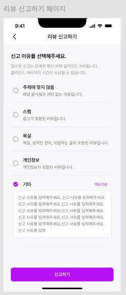

# 4-4 상점상세 리뷰 신고 (클릭)

[← 새 주변상점 - 레거시 로깅 목록](README.md)

플랫폼: ANDROID · IOS · WEB  
원문 상태: 완료

원문에 과거·새 로깅 구분이 없어 아래 정의와 참고사진을 원문 순서로 표시합니다.

원문 미기재 항목: `event_name`, `screen_view`, `value`. 값을 추정하지 않았습니다.

신고 페이지에 들어온 후 사유를 선택하고 신고하기 버튼 클릭 로깅입니다

event\_params.key

- event\_label : shop\_detail\_view\_review\_report

- value 

- 주제에 맞지 않음
- 스팸
- 욕설
- 개인정보
- 기타 (문자열 값)

- event\_category : click

---

---

원문 정보

원본 ID: `e140221954bc8389be01018800d08542`  
[보존 원문](../../_archive/original/notion/pages/e140221954bc8389be01018800d08542.md)

