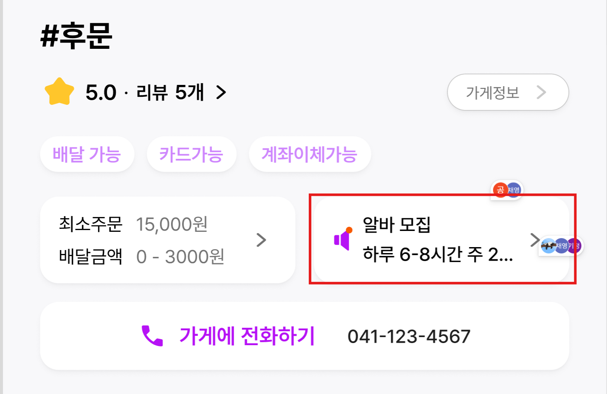

# 5.0 혜택 페이지 진입

[← 새 주변상점 - 레거시 로깅 목록](README.md)

플랫폼: ANDROID · IOS · WEB  
원문 상태: 로깅 필요

원문에 과거·새 로깅 구분이 없어 아래 정의와 참고사진을 원문 순서로 표시합니다.

원문 미기재 항목: `event_name`, `screen_view`, `event_category`. 값을 추정하지 않았습니다.

<callout icon="❗">
기존 로깅이 존재해서 아래 적힌 새 로깅으로 변경해주시면 되겠습니다
</callout>

기존 로깅

event\_params.key

- event\_label : shop\_detail\_view\_info
- value : \{상점이름\}
- event\_category :
  - click

event\_params.key

- event\_label : shop\_benefit\_entry

- value : \{상점이름\} 

- event\_category : 

- click 

- 사진

---

원문 정보

원본 ID: `a310221954bc8230a71701121cc9bc52`  
[보존 원문](../../_archive/original/notion/pages/a310221954bc8230a71701121cc9bc52.md)

