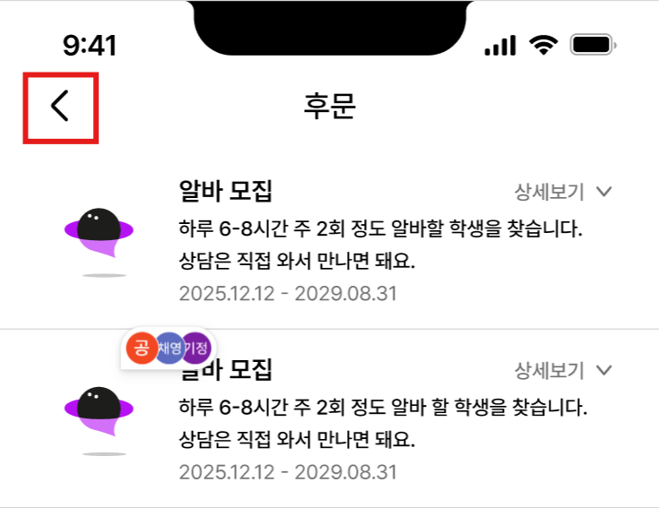

# 5.1 혜택 페이지 이탈

[← 새 주변상점 - 레거시 목록](README.md)

플랫폼: ANDROID, IOS, WEB  
원문 상태: 로깅 필요  
[Notion 기준 명세](https://app.notion.com/p/5150221954bc836e9f2e0190ab753d43)  
원본 ID: `5150221954bc836e9f2e0190ab753d43`

<!-- notion-body:start -->
event\_params.key

- event\_label : shop\_benefit\_back
- value : \{상점이름\}
- event\_category :

    - click
- 사진


<!-- notion-body:end -->

<details>
<summary>Notion 원문 속성 전체</summary>

```json
{
  "platform": [
    "ANDROID",
    "IOS",
    "WEB"
  ],
  "url": "https://app.notion.com/p/5150221954bc836e9f2e0190ab753d43",
  "상태": "로깅 필요",
  "생성일": "2026-11-23T13:39:10.237Z",
  "이벤트 이름": "5.1 혜택 페이지 이탈",
  "태그": [
    "5. 새 혜택페이지"
  ]
}
```

</details>
