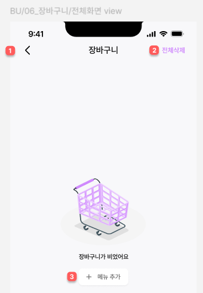

# [레거시] 6-1 장바구니 진입 후 뒤로가기

> **레거시 문서** · 과거 구현과 로깅을 확인하기 위한 보존 자료입니다.

[← 새 주변상점 - 레거시 로깅 목록](README.md)

플랫폼: ANDROID · IOS  
원문 상태: 로깅 필요

원문에 과거·새 로깅 구분이 없어 아래 정의와 참고사진을 원문 순서로 표시합니다.

원문 미기재 항목: `event_name`, `screen_view`, `value`, `event_category`. 값을 추정하지 않았습니다.

장바구니 진입 후, 좌측 상단의 버튼 또는 스와이프로 이탈 로깅입니다.

event\_params.key

- event\_label : cart\_back

- value : 

- event\_category : 

- click 

- swipe

- previous\_page : 장바구니

- current\_page : \{카테고리\}

- duration\_time : 장바구니에서 머무르는 시간  

---

원문 정보

원본 ID: `ba30221954bc82f3879981ef0ecc1d03`  
[보존 원문](../../_archive/original/notion/pages/ba30221954bc82f3879981ef0ecc1d03.md)

