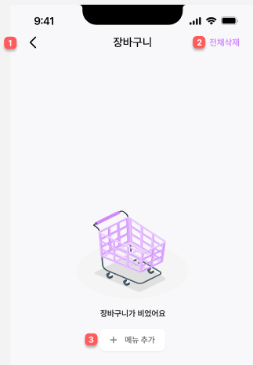

# 6-2 장바구니 삭제 

[← 새 주변상점 - 레거시 목록](README.md)

플랫폼: ANDROID, IOS  
원문 상태: 로깅 필요  
[Notion 기준 명세](https://app.notion.com/p/6a60221954bc8221a7e3012855cec68e)  
원본 ID: `6a60221954bc8221a7e3012855cec68e`

<!-- notion-body:start -->


우측 상단의 전체삭제를 눌러 장바구니를 비우는 버튼 클릭 로깅입니다.

event\_params.key

- event\_label : cart\_remove
- value :
- event\_category :

    - click
<!-- notion-body:end -->

<details>
<summary>Notion 원문 속성 전체</summary>

```json
{
  "platform": [
    "ANDROID",
    "IOS"
  ],
  "url": "https://app.notion.com/p/6a60221954bc8221a7e3012855cec68e",
  "상태": "로깅 필요",
  "생성일": "2026-11-23T13:39:09.353Z",
  "이벤트 이름": "6-2 장바구니 삭제 "
}
```

</details>
