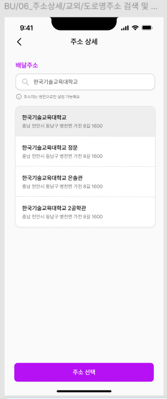

# 7-10 결제 → 교외 주문 페이지 주소 선택 (6월 29일 수정)

[← 새 주변상점 - 레거시 목록](README.md)

플랫폼: WEB  
원문 상태: 로깅 필요  
[Notion 기준 명세](https://app.notion.com/p/0c70221954bc823da095015406794837)  
원본 ID: `0c70221954bc823da095015406794837`

<!-- notion-body:start -->


하단의 주소 선택 버튼 클릭 시 찍히는 로깅입니다

event\_params.key

- event\_label : payment\_off\_campus\_addressClick
- value : 주소명
- event\_category :

    - click
<!-- notion-body:end -->

<details>
<summary>Notion 원문 속성 전체</summary>

```json
{
  "platform": [
    "WEB"
  ],
  "url": "https://app.notion.com/p/0c70221954bc823da095015406794837",
  "상태": "로깅 필요",
  "생성일": "2026-11-23T13:39:11.428Z",
  "이벤트 이름": "7-10 결제 → 교외 주문 페이지 주소 선택 (6월 29일 수정)"
}
```

</details>
