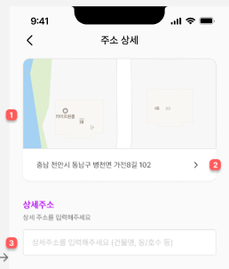

# [레거시] 7-11 결제 → 교외 주문 페이지 주소 재설정

> **레거시 문서** · 과거 구현과 로깅을 확인하기 위한 보존 자료입니다.

[← 새 주변상점 - 레거시 로깅 목록](README.md)

플랫폼: WEB  
원문 상태: 로깅 필요

원문에 과거·새 로깅 구분이 없어 아래 정의와 참고사진을 원문 순서로 표시합니다.

원문 미기재 항목: `event_name`, `screen_view`, `value`, `event_category`. 값을 추정하지 않았습니다.

2번. 주소 재설정 버튼 클릭 시 발생 로깅입니다

event\_params.key

- event\_label : payment\_off\_campus\_address\_reset
- value :
- event\_category :
  - click

---

원문 정보

원본 ID: `80f0221954bc83d49a348160587646a2`  
[보존 원문](../../_archive/original/notion/pages/80f0221954bc83d49a348160587646a2.md)

