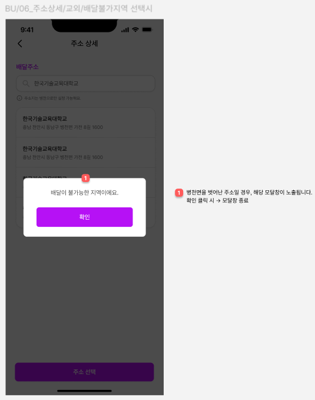

# 7-12 결제 → 교외 주문 페이지 배달 불가능 지역

[← 새 주변상점 - 레거시 목록](README.md)

플랫폼: WEB  
원문 상태: 로깅 필요  
[Notion 기준 명세](https://app.notion.com/p/7ff0221954bc824c87a2019d19f6d8ad)  
원본 ID: `7ff0221954bc824c87a2019d19f6d8ad`

<!-- notion-body:start -->


event\_params.key

- event\_label : payment\_off\_campus\_unavailableArea
- value :
- event\_category :
  - click
<!-- notion-body:end -->

<details>
<summary>Notion 원문 속성 전체</summary>

```json
{
  "platform": [
    "WEB"
  ],
  "url": "https://app.notion.com/p/7ff0221954bc824c87a2019d19f6d8ad",
  "상태": "로깅 필요",
  "생성일": "2026-11-23T13:39:11.664Z",
  "이벤트 이름": "7-12 결제 → 교외 주문 페이지 배달 불가능 지역"
}
```

</details>
