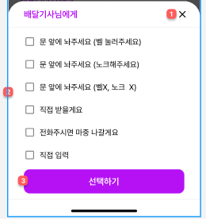

# 7-13 결제 → 교내 및 교외 주문 페이지 기사님 요청사항

[← 새 주변상점 - 레거시 목록](README.md)

플랫폼: WEB  
원문 상태: 로깅 필요  
[Notion 기준 명세](https://app.notion.com/p/a980221954bc82ffb56981ddc3ba0c53)  
원본 ID: `a980221954bc82ffb56981ddc3ba0c53`

<!-- notion-body:start -->


- 교내 및  교외 주문 페이지에서 동일하게 심어주시면 됩니다!
- 2번 체크박스 선택 후
- 3번 선택하기까지 클릭 시 발생하는 로깅입니다

event\_params.key

- event\_label : payment\_delivery\_note
- value :
- 문 앞에 놔주세요(벨 눌러주세요)
- 문 앞에 놔주세요(노크 해주세요)
- 문 앞에 놔주세요(벨X, 노크X)
- 직접 받을게요
- 전화주시면 마중 나갈게요
- 직접 입력
- event\_category :
  - click
<!-- notion-body:end -->

<details>
<summary>Notion 원문 속성 전체</summary>

```json
{
  "platform": [
    "WEB"
  ],
  "url": "https://app.notion.com/p/a980221954bc82ffb56981ddc3ba0c53",
  "상태": "로깅 필요",
  "생성일": "2026-11-23T13:39:11.815Z",
  "이벤트 이름": "7-13 결제 → 교내 및 교외 주문 페이지 기사님 요청사항"
}
```

</details>
