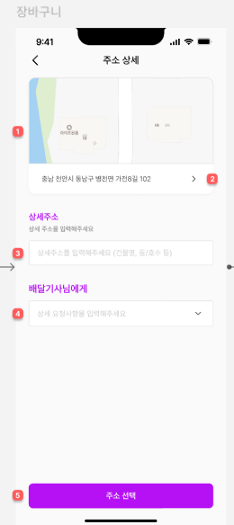

# 7-14 결제 → 교내 및 교외 주문 페이지 주소 선택

[← 새 주변상점 - 레거시 목록](README.md)

플랫폼: WEB  
원문 상태: 로깅 필요  
[Notion 기준 명세](https://app.notion.com/p/a830221954bc8301a9f6815e32d808aa)  
원본 ID: `a830221954bc8301a9f6815e32d808aa`

<!-- notion-body:start -->


- 교내 및 교외 동일하게 적용해주시면 됩니다
- 5번 주소 선택 클릭 로깅으로, 다시 결제 페이지로 이동합니다

event\_params.key

- event\_label : payment\_address\_select
- value : ‘선택된 주소’ 로 가능할까요?
- event\_category :
  - click
<!-- notion-body:end -->

<details>
<summary>Notion 원문 속성 전체</summary>

```json
{
  "platform": [
    "WEB"
  ],
  "url": "https://app.notion.com/p/a830221954bc8301a9f6815e32d808aa",
  "상태": "로깅 필요",
  "생성일": "2026-11-23T13:39:11.939Z",
  "이벤트 이름": "7-14 결제 → 교내 및 교외 주문 페이지 주소 선택"
}
```

</details>
