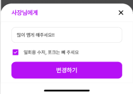

# 7-16 결제 페이지 가게 요청사항 설정

[← 새 주변상점 - 레거시 목록](README.md)

플랫폼: WEB  
원문 상태: 로깅 필요  
[Notion 기준 명세](https://app.notion.com/p/b420221954bc83afab2b81e6d234d6a7)  
원본 ID: `b420221954bc83afab2b81e6d234d6a7`

<!-- notion-body:start -->




4번 요청사항 클릭 후 오른쪽 시트가 올라옵니다

아래와 같이 사용자가 입력하는 요청사항과 체크박스 여부를 동시에 value에 넣을 수 있을까요?

문제가 있다면 연락 부탁드리겠습니다!

event\_params.key

- event\_label : payment\_owner\_note
- value :

  - 요청사항, 체크박스O
  - 요청사항, 체크박스X
- event\_category :

  - click
<!-- notion-body:end -->

<details>
<summary>Notion 원문 속성 전체</summary>

```json
{
  "platform": [
    "WEB"
  ],
  "url": "https://app.notion.com/p/b420221954bc83afab2b81e6d234d6a7",
  "상태": "로깅 필요",
  "생성일": "2026-11-23T13:39:12.195Z",
  "이벤트 이름": "7-16 결제 페이지 가게 요청사항 설정"
}
```

</details>
