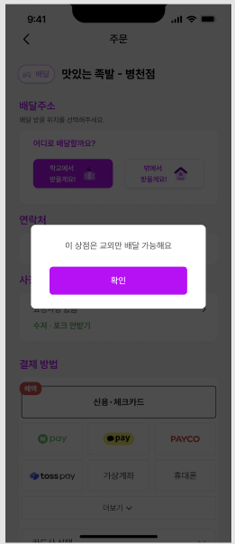

# 7-17 결제 페이지 결제 실패 (교외만 배달 가능, 6월 29일 수정)

[← 새 주변상점 - 레거시 목록](README.md)

플랫폼: WEB  
원문 상태: 로깅 필요  
[Notion 기준 명세](https://app.notion.com/p/7910221954bc83fb8f378100284c8523)  
원본 ID: `7910221954bc83fb8f378100284c8523`

<!-- notion-body:start -->


결제 페이지에서 결제에 실패하여 해당 확인 버튼 클릭 로깅입니다<br />

event\_params.key

- event\_label : payment\_delievery\_only\_campus\_off
- value :

  - \{상점이름\}
- event\_category :

  - click
<!-- notion-body:end -->

<details>
<summary>Notion 원문 속성 전체</summary>

```json
{
  "platform": [
    "WEB"
  ],
  "url": "https://app.notion.com/p/7910221954bc83fb8f378100284c8523",
  "상태": "로깅 필요",
  "생성일": "2026-11-23T13:39:12.453Z",
  "이벤트 이름": "7-17 결제 페이지 결제 실패 (교외만 배달 가능, 6월 29일 수정)"
}
```

</details>
