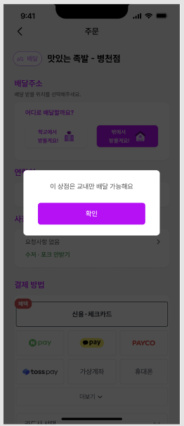

# 7-18 결제 페이지 결제 실패 (교내만 배달 가능, 6월 29일 수정)

[← 새 주변상점 - 레거시 로깅 목록](README.md)

플랫폼: WEB  
원문 상태: 로깅 필요

원문에 과거·새 로깅 구분이 없어 아래 정의와 참고사진을 원문 순서로 표시합니다.

원문 미기재 항목: `event_name`, `screen_view`, `value`, `event_category`. 값을 추정하지 않았습니다.

결제 페이지에서 결제에 실패하여 해당 확인 버튼 클릭 로깅입니다 

event\_params.key

- event\_label : payment\_delievery\_onlyCampus

- value : 

- \{상점이름\}

- event\_category :

- click

---

원문 정보

원본 ID: `1de0221954bc828caabe0115f688e43c`  
[보존 원문](../../_archive/original/notion/pages/1de0221954bc828caabe0115f688e43c.md)

