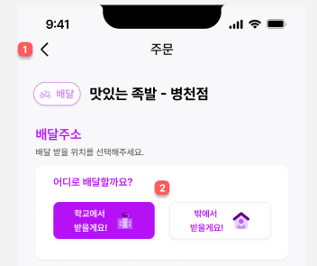

# 7-2 결제 페이지 배달 위치 클릭

[← 새 주변상점 - 레거시 목록](README.md)

플랫폼: WEB  
원문 상태: 로깅 필요  
[Notion 기준 명세](https://app.notion.com/p/c010221954bc827bbfae01cb9c1cb4ab)  
원본 ID: `c010221954bc827bbfae01cb9c1cb4ab`

<!-- notion-body:start -->


2번에 해당

event\_params.key

- event\_label : payment\_deliveryLocation
- value : 교내, 교외
- event\_category :
  - click
<!-- notion-body:end -->

<details>
<summary>Notion 원문 속성 전체</summary>

```json
{
  "platform": [
    "WEB"
  ],
  "url": "https://app.notion.com/p/c010221954bc827bbfae01cb9c1cb4ab",
  "상태": "로깅 필요",
  "생성일": "2026-11-23T13:39:11.661Z",
  "이벤트 이름": "7-2 결제 페이지 배달 위치 클릭"
}
```

</details>
