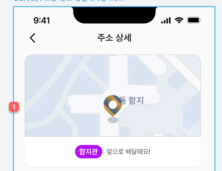

# 7-4 결제 → 교내 주문 페이지 교내 주소 맵 설정

[← 새 주변상점 - 레거시 로깅 목록](README.md)

플랫폼: WEB  
원문 상태: 로깅 필요

원문에 과거·새 로깅 구분이 없어 아래 정의와 참고사진을 원문 순서로 표시합니다.

원문 미기재 항목: `event_name`, `screen_view`, `value`, `event_category`. 값을 추정하지 않았습니다.

event\_params.key

- event\_label : payment\_campus\_map

- value : 

- event\_category :

- click

---

원문 정보

원본 ID: `c950221954bc826cb37d016b239892a7`  
[보존 원문](../../_archive/original/notion/pages/c950221954bc826cb37d016b239892a7.md)

