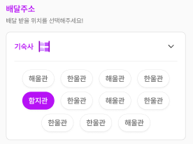

# [레거시] 7-5 결제 → 교내 주문 페이지 기숙사 위치 설정

> **레거시 문서** · 과거 구현과 로깅을 확인하기 위한 보존 자료입니다.

[← 새 주변상점 - 레거시 로깅 목록](README.md)

플랫폼: WEB  
원문 상태: 로깅 필요

원문에 과거·새 로깅 구분이 없어 아래 정의와 참고사진을 원문 순서로 표시합니다.

원문 미기재 항목: `event_name`, `screen_view`, `event_category`. 값을 추정하지 않았습니다.

2번에 해당하고 세부 기숙사 클릭 시 로깅입니다

event\_params.key

- event\_label : payment\_campus\_dormitory
- value : 해울관(101), 예지관(102), 예솔관(103), 다솔관(104), 함지관(105), 한울관(106), 솔빛관(201), 청솔관(202), IH관(203), 은솔관(204), 참빛관(205)
- event\_category :
  - click

---

원문 정보

원본 ID: `5a20221954bc82db90a18148a795d699`  
[보존 원문](../../_archive/original/notion/pages/5a20221954bc82db90a18148a795d699.md)

