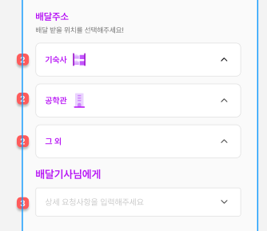

# 7-6 결제 → 교내 주문 페이지 공학관 위치 설정

[← 새 주변상점 - 레거시 목록](README.md)

플랫폼: WEB  
원문 상태: 로깅 필요  
[Notion 기준 명세](https://app.notion.com/p/ee00221954bc82728bd181d04717d5ef)  
원본 ID: `ee00221954bc82728bd181d04717d5ef`

<!-- notion-body:start -->


기숙사의 경우와 동일하게 세부 공학관 클릭 시 로깅입니다

event\_params.key

- event\_label : payment\_campus\_engineeringBuilding
- value : 공학 1관, 공학 2관, 공학 3관, 공학 4관 A동, 공학 4관 B동, 담헌실학관, 인문경영관
- event\_category :

  - click
<!-- notion-body:end -->

<details>
<summary>Notion 원문 속성 전체</summary>

```json
{
  "platform": [
    "WEB"
  ],
  "url": "https://app.notion.com/p/ee00221954bc82728bd181d04717d5ef",
  "상태": "로깅 필요",
  "생성일": "2026-11-23T13:39:12.163Z",
  "이벤트 이름": "7-6 결제 → 교내 주문 페이지 공학관 위치 설정"
}
```

</details>
