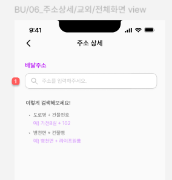

# 7-8 결제 → 교외 주문 페이지 이탈 

[← 새 주변상점 - 레거시 목록](README.md)

플랫폼: WEB  
원문 상태: 로깅 필요  
[Notion 기준 명세](https://app.notion.com/p/91d0221954bc8375baf78193d675f579)  
원본 ID: `91d0221954bc8375baf78193d675f579`

<!-- notion-body:start -->


교외 주문 페이지에서 좌측 상단의 이탈 로깅입니다 

event\_params.key

- event\_label : payment\_off\_campus\_back
- value :
- event\_category :

    - click
    - swipe
- previous\_page : 교외
- current\_page : 결제
- duration\_time : 교외 페이지에서 머무르는 시간
<!-- notion-body:end -->

<details>
<summary>Notion 원문 속성 전체</summary>

```json
{
  "platform": [
    "WEB"
  ],
  "url": "https://app.notion.com/p/91d0221954bc8375baf78193d675f579",
  "상태": "로깅 필요",
  "생성일": "2026-11-23T13:39:11.148Z",
  "이벤트 이름": "7-8 결제 → 교외 주문 페이지 이탈 "
}
```

</details>
