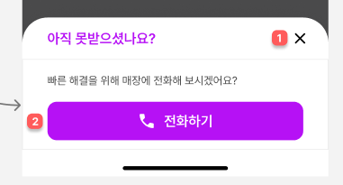

# 8-4 주문 완료 페이지 배달 미도착 이탈

[← 새 주변상점 - 레거시 목록](README.md)

플랫폼: WEB  
원문 상태: 로깅 필요  
[Notion 기준 명세](https://app.notion.com/p/f570221954bc83108a90011c54907a40)  
원본 ID: `f570221954bc83108a90011c54907a40`

<!-- notion-body:start -->




배달을 아직 못 받은 경우 → 1번 x 버튼 클릭 로깅입니다

event\_params.key

- event\_label : order\_comlete\_notRecievedBack
- value :
- event\_category :
  - click
<!-- notion-body:end -->

<details>
<summary>Notion 원문 속성 전체</summary>

```json
{
  "platform": [
    "WEB"
  ],
  "url": "https://app.notion.com/p/f570221954bc83108a90011c54907a40",
  "상태": "로깅 필요",
  "생성일": "2026-11-23T13:39:11.792Z",
  "이벤트 이름": "8-4 주문 완료 페이지 배달 미도착 이탈"
}
```

</details>
