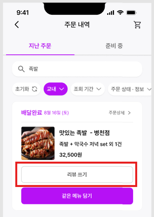

# 9-3 주문내역 검색창 리뷰쓰기

[← 새 주변상점 - 레거시 목록](README.md)

플랫폼: ANDROID, IOS  
원문 상태: 로깅 필요  
[Notion 기준 명세](https://app.notion.com/p/ef00221954bc827488c2011caabcda64)  
원본 ID: `ef00221954bc827488c2011caabcda64`

<!-- notion-body:start -->


검색창에서 텍스트 입력한 후 리뷰 쓰기 클릭 로깅입니다 

event\_params.key

- event\_label : orderHistory\_search\_review
- value :

  - \{상점이름\}
- event\_category : click
- previous\_page :
- current\_page :
- duration\_time :
<!-- notion-body:end -->

<details>
<summary>Notion 원문 속성 전체</summary>

```json
{
  "platform": [
    "ANDROID",
    "IOS"
  ],
  "url": "https://app.notion.com/p/ef00221954bc827488c2011caabcda64",
  "상태": "로깅 필요",
  "생성일": "2026-11-23T13:39:14.257Z",
  "이벤트 이름": "9-3 주문내역 검색창 리뷰쓰기"
}
```

</details>
