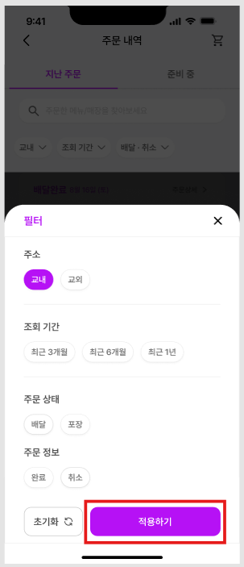

# 9-5 주문내역 필터 적용하기

[← 새 주변상점 - 레거시 로깅 목록](README.md)

플랫폼: ANDROID · IOS  
원문 상태: 로깅 필요

원문에 과거·새 로깅 구분이 없어 아래 정의와 참고사진을 원문 순서로 표시합니다.

원문 미기재 항목: `event_name`, `screen_view`, `value`. 값을 추정하지 않았습니다.

필터를 누르고 적용하기 버튼까지 클릭했을 때 발생되는 로깅입니다. 

event\_params.key

- event\_label : orderHistory\_filter

- value : 

- 예시: 

- 교내, 최근 3개월, 배달, 완료

- event\_category : click

- previous\_page :

- current\_page :

- duration\_time :

---

원문 정보

원본 ID: `71e0221954bc83f3b2d78190f78f998f`  
[보존 원문](../../_archive/original/notion/pages/71e0221954bc83f3b2d78190f78f998f.md)

