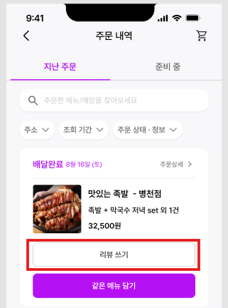

# 9-6 주문내역 리뷰쓰기

[← 새 주변상점 - 레거시 목록](README.md)

플랫폼: ANDROID, IOS  
원문 상태: 로깅 필요  
[Notion 기준 명세](https://app.notion.com/p/6950221954bc82e3ab7b817fa69a5ebc)  
원본 ID: `6950221954bc82e3ab7b817fa69a5ebc`

<!-- notion-body:start -->


event\_params.key

- event\_label : orderHistory\_review
- value :

  - \{상점이름\}
- event\_category : click
- previous\_page :
- current\_page :
- duration\_time :
<!-- notion-body:end -->

<details>
<summary>Notion 원문 속성 전체</summary>

```json
{
  "platform": [
    "ANDROID",
    "IOS"
  ],
  "url": "https://app.notion.com/p/6950221954bc82e3ab7b817fa69a5ebc",
  "상태": "로깅 필요",
  "생성일": "2026-11-23T13:39:14.507Z",
  "이벤트 이름": "9-6 주문내역 리뷰쓰기"
}
```

</details>
